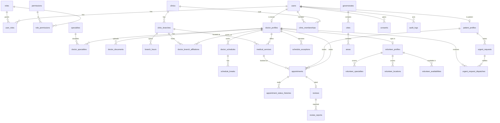

# Database Schema (PostgreSQL 18)

Full column-level design: `specs/001-medical-booking-platform/data-model.md`.
Source of truth: `backend/database/migrations/` (run `php artisan migrate:fresh --seed` on a clean DB).

Conventions: ULID primary keys (`char(26)`) for domain entities; `bigint identity` for append-only
tables; all timestamps `timestamptz` (UTC); money `numeric(10,2)` EGP; enum columns are `varchar`
with `CHECK (… IN …)` generated from the PHP enums. Extensions: `btree_gist`, `pg_trgm`.

## ERD

## Entities

| Group | Tables |
|---|---|
| Identity & access | users, roles, permissions, role_permissions, user_roles, patient_profiles, doctor_profiles, doctor_documents, password_reset_tokens, sessions, personal_access_tokens (unused by SPA) |
| Directory | specialties, doctor_specialties, governorates, cities, areas |
| Tenancy | clinics, clinic_memberships, clinic_branches, branch_hours, doctor_branch_affiliations, medical_services |
| Scheduling | doctor_schedules, schedule_breaks, schedule_exceptions, appointments, appointment_status_histories |
| Reviews | reviews, review_reports |
| Urgent | volunteer_profiles, volunteer_specialties, volunteer_locations, volunteer_availabilities, urgent_requests, urgent_request_dispatches |
| Cross-cutting | notifications, audit_logs, consents, platform_settings, cache, jobs, failed_jobs, job_batches |

## Critical constraints

| Constraint | Table | Guarantees |
|---|---|---|
| `appointments_no_doctor_overlap` — `EXCLUDE USING gist (doctor_profile_id WITH =, tstzrange(starts_at, blocked_until,'[)') WITH &&) WHERE status IN ('pending_confirmation','confirmed')` | appointments | No two blocking appointments of one doctor overlap (incl. buffer). Half-open ranges allow back-to-back. |
| `appointments_period` — `ends_at > starts_at AND blocked_until >= ends_at` | appointments | Valid periods |
| `appointments_pending_has_hold`, `appointments_cancel_recorded` | appointments | Pending holds expire; cancellations are timestamped |
| `urgent_request_dispatches_one_winner` — partial UNIQUE (urgent_request_id) WHERE status='accepted' | urgent_request_dispatches | Exactly one winning acceptance |
| `urgent_requests_acceptance_state` | urgent_requests | accepted/in_progress/completed ⇔ accepted doctor set |
| UNIQUE(appointment_id) | reviews | One review per appointment |
| `reviews_rating_range` 1–5, prices ≥ 0, durations 5–240, horizon 1–365, buffer ≤ 120 | various | Business bounds |
| `medical_services_in_person_has_branch`, `medical_services_branch_clinic` | medical_services | In-person services are tied to a tenant branch |
| `doctor_specialties_one_primary` partial UNIQUE | doctor_specialties | One primary specialty |
| UNIQUE(clinic_id, user_id) | clinic_memberships | One membership per clinic/user |
| `users_phone_unique` partial UNIQUE WHERE phone NOT NULL; UNIQUE(email) | users | Identity uniqueness |
| `volunteer_availabilities_period` — ≤ 24 h | volunteer_availabilities | Availability is always time-bounded |
| FKs `RESTRICT` on specialties/branches/services referenced by history | — | History is never orphaned; deactivate instead of delete |

## Indexes (by query pattern)

| Query | Index |
|---|---|
| Doctor calendar: a doctor's appointments in a range ordered by time | `appointments (doctor_profile_id, starts_at)` |
| Patient dashboard | `appointments (patient_profile_id, starts_at)` |
| Clinic appointments | `appointments (clinic_id, starts_at)` |
| Hold expiry sweep | `appointments (status, hold_expires_at)` |
| Reminders / stats | `appointments (status, starts_at)` |
| Public discovery filter | `doctor_profiles (verification_status, is_active)`; sort indexes on `rating_avg`, `min_price`, `next_available_at` |
| Name search (Arabic/English, partial) | GIN `gin_trgm_ops` on `doctor_profiles.search_text` (normalized copy; display text untouched) |
| Specialty filter | `doctor_specialties (specialty_id)` + PK |
| Location filter | `clinic_branches (governorate_id, city_id)`, `clinic_branches (clinic_id)` |
| Schedules by weekday | `doctor_schedules (doctor_profile_id, day_of_week)`; exceptions `(doctor_profile_id, date)` |
| Urgent matching | `urgent_requests (status)`, `(status, expires_at)`; dispatches `(doctor_profile_id, status)`, UNIQUE `(urgent_request_id, doctor_profile_id)` |
| Audit review | `audit_logs (subject_type, subject_id)`, `(actor_user_id, created_at)`, `(action, created_at)` |

Measured (2,007 doctors, `EXPLAIN ANALYZE`): name search 7 ms, specialty+rating sort 0.9 ms
(uses `rating_avg` index), price filter 2 ms. At this size the planner correctly prefers sequential
scans for some filters; the trigram index takes over as the table grows.

## Tenant isolation

Tenant-owned rows carry `clinic_id` (branches, memberships, affiliations, clinic services,
appointments). All `/clinics/{clinic}/…` routes resolve the clinic only through the caller's active
membership (`ResolveClinicTenant`) and every sub-resource lookup is `where('clinic_id', …)`.
Global data (users/patients, specialties, geography) is not tenant-owned.
